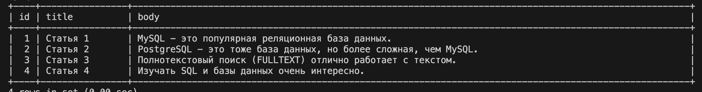
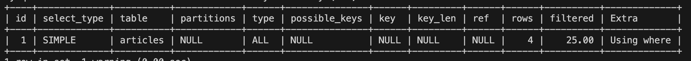
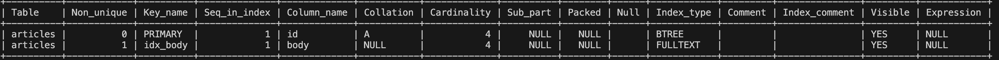
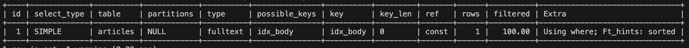
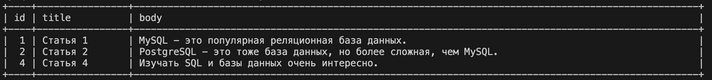
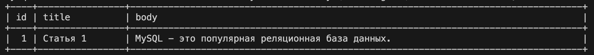
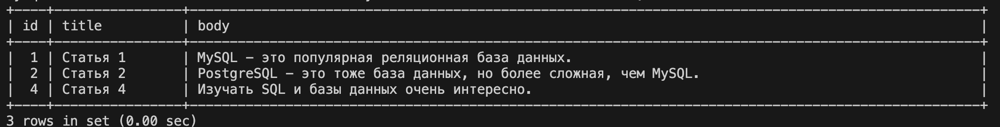
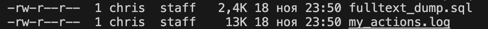
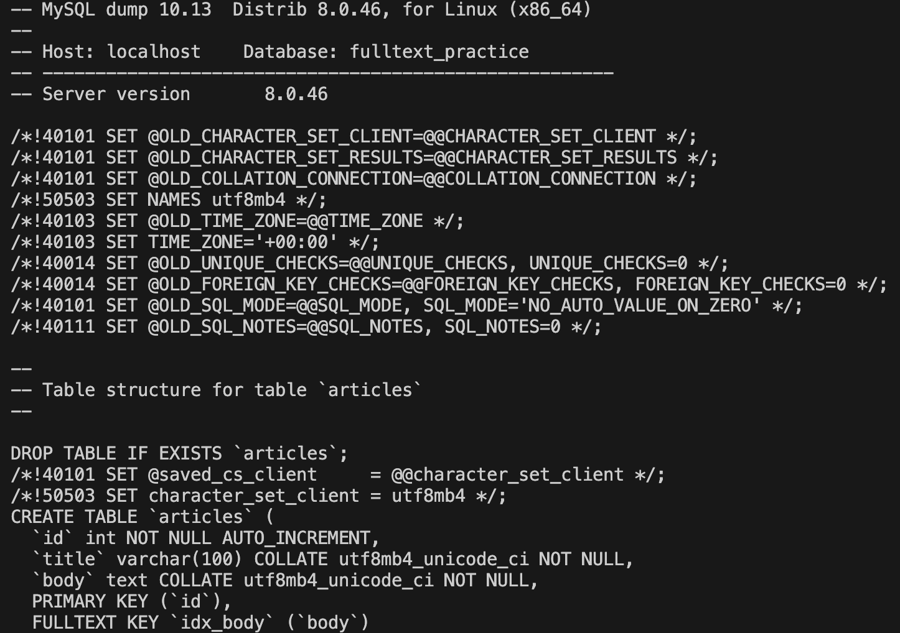
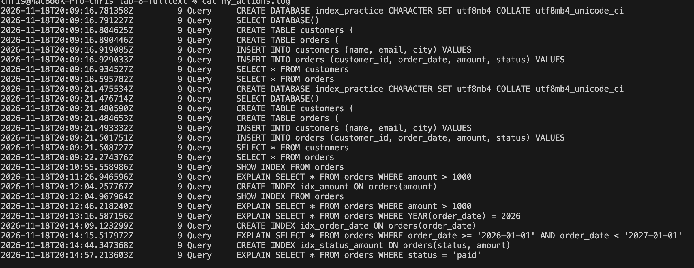

# 🗄️ Отчёт: Полнотекстовый поиск (FULLTEXT) в MySQL


> **Дисциплина:** Основы проектирования баз данных
> **Задание:** Изучение механизма полнотекстового поиска (FULLTEXT), сравнение с `LIKE`, булев режим.
> **Дата:** ноябрь 2026

---

## 📑 Содержание

1. [Цель работы](#-цель-работы)
2. [Среда выполнения](#-среда-выполнения)
3. [Ход выполнения](#-ход-выполнения)
   - [1. Создание БД и таблицы](#1-создание-бд-и-таблицы)
   - [2. Сравнение `LIKE` и `FULLTEXT`](#2-сравнение-like-и-fulltext)
   - [3. Естественный язык (Natural Language Mode)](#3-естественный-язык-natural-language-mode)
   - [4. Булев режим (Boolean Mode)](#4-булев-режим-boolean-mode)
   - [5. Поиск с усечением (Wildcard)](#5-поиск-с-усечением-wildcard)
   - [6. Дамп и лог](#6-дамп-и-лог)
4. [Вывод](#-вывод)
5. [Приложения](#-приложения)

---

## 🎯 Цель работы

Научиться использовать полнотекстовый поиск (`MATCH ... AGAINST`) для быстрого поиска по текстовым полям, изучить разницу между обычным `LIKE` и `FULLTEXT`-индексом, а также освоить булев режим поиска.

---

## 🛠 Среда выполнения

| Компонент | Версия / Значение |
|-----------|-------------------|
| ОС | macOS (Apple Silicon) |
| Терминал | zsh |
| Docker | Docker Desktop |
| Образ MySQL | `mysql:8.0` → **MySQL Community Server 8.0.46** |
| Кодировка | `utf8mb4` / `utf8mb4_unicode_ci` |

---

## 🚀 Ход выполнения

### 1. Создание БД и таблицы
Создана база `fulltext_practice` и таблица `articles` с текстовым полем `body` типа `TEXT`. Таблица заполнена тестовыми статьями.



---

### 2. Сравнение `LIKE` и `FULLTEXT`

Запрос с `LIKE '%MySQL%'` не может использовать индекс (из-за знака `%` в начале) и вызывает полный перебор строк (`type: ALL`).
```sql
EXPLAIN SELECT * FROM articles WHERE body LIKE '%MySQL%';
```


Создан полнотекстовый индекс `idx_body`. В списке индексов он отображается с типом `FULLTEXT`.
```sql
ALTER TABLE articles ADD FULLTEXT idx_body(body);
SHOW INDEX FROM articles;
```


Запрос с `MATCH(body) AGAINST('MySQL')` использует новый индекс. В плане запроса появляется `type: fulltext`.
```sql
EXPLAIN SELECT * FROM articles WHERE MATCH(body) AGAINST('MySQL');
```


---

### 3. Естественный язык (Natural Language Mode)

Поиск по словам «база» и «данных». MySQL автоматически отбрасывает стоп-слова и ищет по корням.
```sql
SELECT * FROM articles WHERE MATCH(body) AGAINST('база данных');
```


---

### 4. Булев режим (Boolean Mode)

Позволяет использовать операторы:
*   `+` — слово **обязательно** должно быть.
*   `-` — слово **не должно** встречаться.

Запрос ищет статьи, где точно есть «MySQL», но нет «PostgreSQL».
```sql
SELECT * FROM articles WHERE MATCH(body) AGAINST('+MySQL -PostgreSQL' IN BOOLEAN MODE);
```


---

### 5. Поиск с усечением (Wildcard)

Оператор `*` в булевом режиме позволяет искать слова по префиксу (например, «база», «базы», «базовый»).
```sql
SELECT * FROM articles WHERE MATCH(body) AGAINST('баз*' IN BOOLEAN MODE);
```


---

### 6. Дамп и лог

Сформирован чистый дамп базы данных (`fulltext_dump.sql`) и отфильтрованный лог действий (`my_actions.log`) с помощью `mysqldump` и `grep`.





---

## ✅ Вывод

В ходе работы:

1. ✅ Изучен механизм полнотекстового поиска (`FULLTEXT`).
2. ✅ Доказано, что `FULLTEXT`-индекс кардинально ускоряет поиск по тексту в отличие от `LIKE '%...%'`, который вызывает полный перебор.
3. ✅ Освоен булев режим поиска, позволяющий комбинировать обязательные и исключающие слова, а также искать по префиксу.
4. ✅ Проверена работа естественно-языкового режима.
5. ✅ Создан дамп базы и лог действий пользователя.

---

## 📎 Приложения

- 💾 [Дамп БД](fulltext_dump.sql)
- 📄 [Лог действий](my_actions.log)

---

<div align="center">
  <i>© 2026</i>
</div>